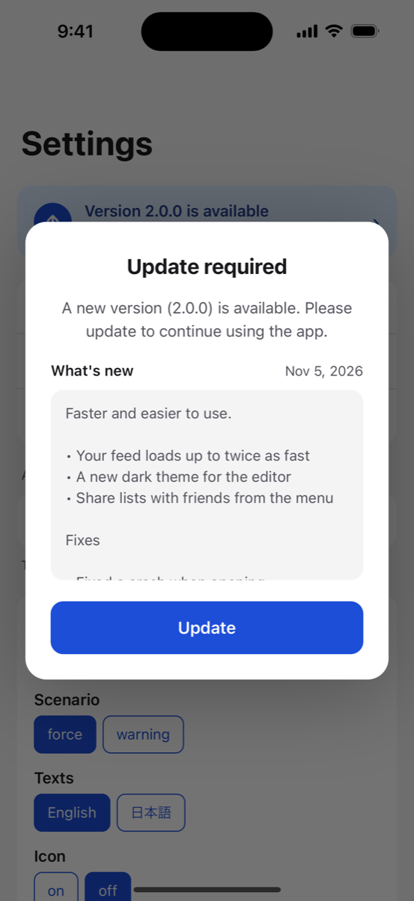
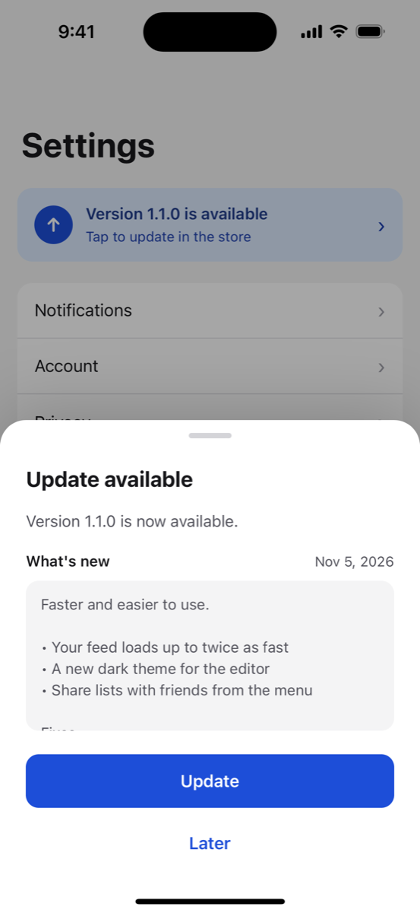

# react-native-store-version

Check the App Store / Google Play version of your React Native / Expo app and show a **force update** or a dismissible **update available** prompt. JavaScript only, no native code, zero runtime dependencies.

```tsx
import { StoreVersionProvider } from 'react-native-store-version';

export default function Root() {
  return (
    <StoreVersionProvider>
      <App />
    </StoreVersionProvider>
  );
}
```

That is all. On launch, the Provider reads the app's version and bundle ID / package name (via `expo-application` or `react-native-device-info`), asks the store for the latest version, and shows a modal when the app is behind: a force-update card for a **major** difference and a dismissible bottom sheet for **minor** / **patch**. Your app renders immediately and keeps working if the check fails.

The screenshots show the default UI on iOS with `showReleaseNotes` turned on: the force update (modal) and the update available prompt (bottom sheet).

|                                                                                  Force update                                                                                  |                                                                                   Update available                                                                                    |
| :----------------------------------------------------------------------------------------------------------------------------------------------------------------------------: | :-----------------------------------------------------------------------------------------------------------------------------------------------------------------------------------: |
|  |  |

I've only been updating occasionally, but I'd be happy to sponsor you to keep me motivated.
https://github.com/sponsors/watanabeyu

Upgrading from v1? See [MIGRATION.md](./MIGRATION.md). Calling `checkVersion()` on 2.0? It changed in 2.1.0: see [2.0 → 2.1](./MIGRATION.md#20--21) in the same guide. Release notes are in [CHANGELOG.md](./CHANGELOG.md).

## Table of contents

- [Installation](#installation)
- [Requirements](#requirements)
- [How it works](#how-it-works)
- [Policy: force, warning or nothing](#policy-force-warning-or-nothing)
- [Customizing the UI](./guides/customizing-ui.md)
- [Your own version source](./guides/version-sources.md)
- [`useStoreVersion` hook](./guides/hook.md)
- [Provider props](#provider-props)
- [Errors](#errors)
- [Notes and caveats](#notes-and-caveats)
- [CI check](./guides/ci.md)
- [Performance](#performance)
- [`checkVersion` / `compareVersion`](./guides/check-version.md)
- [Example app](#example-app)
- [Contributing](#contributing)
- [Credits and license](#credits-and-license)

## Installation

```bash
npm install react-native-store-version
# or
pnpm add react-native-store-version
```

To let the Provider read the app version and ID automatically, have one of these in your app (both are optional peer dependencies; nothing else is required):

| App               | Package                                                  |
| ----------------- | -------------------------------------------------------- |
| Expo              | `expo-application` (`npx expo install expo-application`) |
| Bare React Native | `react-native-device-info`                               |

If neither is installed, pass `version`, `bundleId` and `packageName` to the Provider yourself (see [Provider props](#provider-props)).

## Requirements

|                             | Supported |
| --------------------------- | --------- |
| React Native                | `>=0.73`  |
| React                       | 18 / 19   |
| Expo SDK                    | `>=52`    |
| TypeScript (your app)       | `>=5.0`   |
| Node.js (CI check CLI only) | `>=22.14` |

The library runs anywhere React Native runs except **Expo Go**: inside Expo Go the Provider does nothing (`status: 'skipped'`) because the detected bundle ID belongs to Expo Go itself. Use a development build to try it. It also does nothing on web and on platforms other than iOS / Android.

## How it works

- **Checks on every launch.** Nothing is cached or persisted. The check runs when the Provider mounts (and again on `recheck()`, when `enabled` turns true, or on foreground if you opt in with `recheckOnForeground`).
- **Never blocks your app.** Children render right away. The modal is layered on top once the result is known.
- **Fails quietly.** Timeouts (default 10 s) and errors never show UI; they go to `onError` (and to `console.warn` in development if you don't pass `onError`).
- **Sources.** iOS uses the iTunes Lookup API by bundle ID. Android reads the Google Play web page by package name (about 1.25 MB per check). You can replace both with [your own source](./guides/version-sources.md#your-own-version-source).
- **"Later" lasts until the next launch.** Dismissing the warning is kept in memory only, so it shows again next time the app starts (or sooner, if a newer version appears on a recheck).
- **Store country.** Defaults to the device locale's region (falls back to `us`). Set `country` if your app is published elsewhere.

## Policy: force, warning or nothing

The `policy` prop maps the kind of difference to an action. The default is:

```tsx
<StoreVersionProvider policy={{ major: 'force', minor: 'warning', patch: 'warning' }}>
```

Three forms are accepted:

```tsx
// one action for every difference (same feeling as v1's result === 'new')
<StoreVersionProvider policy="force">

// per kind; omitted keys use the default
<StoreVersionProvider policy={{ minor: 'force' }}>

// a function
<StoreVersionProvider policy={(local, remote) => (remote.startsWith('3.') ? 'force' : 'warning')}>
```

Order of evaluation:

1. If `getMinimumVersion` returns a version and the app is below it, the action is `force` regardless of the policy.
2. If the app is up to date (or newer than the store), the action is `none`.
3. Otherwise the kind of difference (`major` / `minor` / `patch`) picks the action from the policy.

A difference only in the 4th segment (`1.2.3.4` → `1.2.3.5`) or only in a prerelease tag (`1.2.3-beta` → `1.2.3`) counts as `patch`.

> **Warning: Android staged rollouts.**
> If you use a staged rollout on Google Play, users outside the rollout cannot download the new version yet, but the store page already shows it. A force update driven by the store version would lock those users out of your app with no way to update.
> On Android, use `major: 'warning'` (for example `policy={{ major: Platform.OS === 'android' ? 'warning' : 'force' }}`), or decide force updates with [`getMinimumVersion`](./guides/version-sources.md#your-own-version-source) instead of the store version.
> iOS phased releases are not affected: they only throttle _automatic_ updates, and anyone can update manually from the App Store at any time.

## Customizing the UI

Customize the default UI in three levels:

1. Texts
   - Icon and button color
2. Components
3. Hook only

See [Customizing the UI](./guides/customizing-ui.md).

## Your own version source

Return the latest and / or the minimum version from your own source:

- A static JSON file
- Your own API
- Firebase Remote Config

See [Your own version source](./guides/version-sources.md).

## `useStoreVersion` hook

Read the check result in your own components.

See [`useStoreVersion` hook](./guides/hook.md).

## Provider props

All props are optional.

| Prop                  | Default                                                  | Description                                                                                                                                                                                                                                                                                                                                |
| --------------------- | -------------------------------------------------------- | ------------------------------------------------------------------------------------------------------------------------------------------------------------------------------------------------------------------------------------------------------------------------------------------------------------------------------------------ |
| `enabled`             | `true`                                                   | `false` does nothing (`skipped`). Switching to `true` starts a check; switching to `false` cancels it.                                                                                                                                                                                                                                     |
| `version`             | auto                                                     | The app version. **Must be the native version** (`CFBundleShortVersionString` / `versionName`). Don't pass `Constants.expoConfig.version` or `package.json`'s version: they live in the JS bundle and change with OTA updates, which would hide a needed force update. Auto-detected from `expo-application` → `react-native-device-info`. |
| `bundleId`            | auto                                                     | iOS bundle ID.                                                                                                                                                                                                                                                                                                                             |
| `packageName`         | auto                                                     | Android package name.                                                                                                                                                                                                                                                                                                                      |
| `country`             | device region, else `us`                                 | App Store country for the lookup.                                                                                                                                                                                                                                                                                                          |
| `policy`              | `{ major: 'force', minor: 'warning', patch: 'warning' }` | See [Policy](#policy-force-warning-or-nothing). Changing it re-evaluates `action` without a new request.                                                                                                                                                                                                                                   |
| `timeoutMs`           | `10000`                                                  | Timeout for the whole check. On timeout: no UI, `TIMEOUT` to `onError`.                                                                                                                                                                                                                                                                    |
| `recheckOnForeground` | `false`                                                  | Recheck when the app returns from the background (`background` → `active`). On Android this also fires after permission dialogs and other apps, and each check downloads the Play page (about 1.25 MB).                                                                                                                                    |
| `getLatestVersion`    | –                                                        | See [Your own version source](./guides/version-sources.md#your-own-version-source).                                                                                                                                                                                                                                                        |
| `getMinimumVersion`   | –                                                        | See [Your own version source](./guides/version-sources.md#your-own-version-source).                                                                                                                                                                                                                                                        |
| `onResult`            | –                                                        | `(r) => void`, called with `{ result, detail, action, diff, local, remote }` each time a check completes, and again when a `policy` change changes `action`. Not called for `skipped` / `error`.                                                                                                                                           |
| `onError`             | `console.warn` in dev                                    | `(e: StoreVersionError) => void`. May be called more than once per check (for example a failed minimum-version fetch plus a failed store lookup).                                                                                                                                                                                          |
| `texts`               | English                                                  | See [Texts](./guides/customizing-ui.md#1-texts).                                                                                                                                                                                                                                                                                           |
| `icon`                | none                                                     | Image source for the default UI.                                                                                                                                                                                                                                                                                                           |
| `components`          | default UI                                               | See [Components](./guides/customizing-ui.md#2-components).                                                                                                                                                                                                                                                                                 |
| `primaryColor`        | blue                                                     | Button color of the default UI.                                                                                                                                                                                                                                                                                                            |
| `showReleaseNotes`    | `false`                                                  | `true` shows the store's release notes and release date in the default UI (force / warning). The section appears only when release notes came back from the store (never with `getLatestVersion`). Does not apply to `components`. Heading and date format: see [Texts](./guides/customizing-ui.md#1-texts).                               |
| `ui`                  | `true`                                                   | `false` hides the default UI (hook only).                                                                                                                                                                                                                                                                                                  |

## Errors

`onError` and `useStoreVersion().error` receive a `StoreVersionError` with a `code` (and the original error in `cause` when there is one). No code ever shows UI on its own; the app keeps working.

| `code`                      | When                                                                                                        | Check result                                                                     |
| --------------------------- | ----------------------------------------------------------------------------------------------------------- | -------------------------------------------------------------------------------- |
| `LOCAL_VERSION_UNAVAILABLE` | The app version / ID can't be read (no `expo-application` / `react-native-device-info` and nothing passed). | `error`                                                                          |
| `TIMEOUT`                   | The latest version didn't arrive within `timeoutMs`.                                                        | `error`                                                                          |
| `NETWORK`                   | HTTP / network failure, or an unreadable App Store response.                                                | `error`                                                                          |
| `NOT_FOUND`                 | The app isn't on the store (App Store returned no results / Google Play 404).                               | `error`                                                                          |
| `PARSE_FAILED`              | The Google Play page changed and the version couldn't be extracted.                                         | `error`                                                                          |
| `INVALID_VERSION`           | A version can't be compared (for example Google Play's "Varies with device").                               | `error` (or `ready` with `action: 'force'` if the minimum version still applies) |
| `LATEST_VERSION_FAILED`     | `getLatestVersion` threw or returned an empty / non-string value.                                           | `error`                                                                          |
| `MINIMUM_VERSION_FAILED`    | `getMinimumVersion` threw, returned a non-string or a version that can't be compared, or timed out.         | `ready` (minimum rule skipped)                                                   |
| `POLICY_FAILED`             | A `policy` function threw or returned something other than `force` / `warning` / `none`.                    | `error`                                                                          |
| `STORE_URL_UNAVAILABLE`     | The store URL couldn't be looked up or opened (`openStore()` returns `false`).                              | unchanged                                                                        |

## Notes and caveats

- **Native version only.** See `version` in [Provider props](#provider-props). OTA updates (Expo Updates, CodePush) don't change the native version, and that is what the store compares against.
- **App Store cache.** The iTunes Lookup API sits behind a CDN. The library adds a timestamp to the URL and sends `cache-control: no-cache` to get fresh data, but right after you release a new version the lookup may still lag behind for a while.
- **Google Play is scraped.** There is no public API for the Play version, so the library reads the store's web page. The page can change without notice (the version is then reported as `PARSE_FAILED`, with no UI), the request is about 1.25 MB, and Google's terms of service may restrict automated access; review them. If you need certainty, or want to avoid contacting Google Play altogether, use `getLatestVersion` with your own source (`getMinimumVersion` alone still reads the Play page for the latest version).
- **Android staged rollouts** can lock users out when force is driven by the store version. See [Policy](#policy-force-warning-or-nothing).
- **"Later" is not persisted.** There is no storage; the warning returns on the next launch. If you need a longer snooze, use `ui={false}` and the hook with your own storage.
- **`recheckOnForeground` on Android** downloads the Play page on every return to the foreground.
- **Metro `allowOptionalDependencies`.** The optional peers are loaded with `try { require('expo-application') }`. With Metro's default settings a missing peer is fine; if your `metro.config.js` sets `transformer.allowOptionalDependencies: false`, bundling fails when a peer is missing, so install one of them or re-enable the option.
- **Release notes language.** On Android, `releaseNotes` is in the default language of the Play page: the English translation if the app has one, otherwise the app's default language. On iOS it is in the language of the `country` storefront. The two can differ. The same goes for the default UI with `showReleaseNotes`: the heading and the date format follow `texts`, but the notes themselves are in the language the store returns.
- **Other modals.** The default UI is a React Native `Modal` at your root. On iOS, while another `Modal` (or a native modal screen from `react-native-screens` / `expo-router`) is presented, the force / warning modal may not appear, and there is no guarantee that it appears after the other one closes (the reverse can also happen: your modal may not show while this one is open). If a force update must never be missed, use `ui={false}` and show the hook's result in your own screen.
- **Warning dismissal.** The warning sheet also closes with the Android back button, a tap on the backdrop, and the VoiceOver escape gesture, all equivalent to "Later". The force card can't be dismissed.
- **StrictMode.** In development, `getLatestVersion` / `getMinimumVersion` may run twice on mount.
- **`onError` can fire more than once per check.**
- **Expo Go** is skipped. Use a development build.

## CI check

Check the setup and the store lookup of your app in CI with the CLI or the GitHub Action.

See [CI check](./guides/ci.md).

## Performance

Measured in the [example app](./example) on release builds, on a simulator / emulator (iPhone 17 on iOS 26.5; Pixel 3a on API 34), against a published app (GitHub, country `jp`), from mount to `onResult`, median of 5 runs after one warm-up:

|         | `checkVersion()` of v1 (1.x) | v2 Provider (`ui={false}`, IDs given) |
| ------- | ---------------------------- | ------------------------------------- |
| iOS     | 199 ms                       | 161 ms                                |
| Android | 205 ms                       | 198 ms                                |

The first column is the 1.x release of this library, not the `checkVersion()` of 2.1.

Added bundle size for the Provider and the default UI: about 39.8 KB minified / about 11 KB gzipped (Hermes bytecode: about 75 KB more than an empty app). The library has no runtime dependencies.

## `checkVersion` / `compareVersion`

Check the store version outside React, and compare two versions.

See [`checkVersion` / `compareVersion`](./guides/check-version.md).

## Example app

[`example/`](./example) is an Expo app in this repository that switches between the store (its own ID, which is not published), an app that is really on the stores (`github`: the GitHub app's IDs, so the store's version, release notes and release date come back), a static JSON file and a mock API, and shows the Japanese preset, `icon`, `components`, `primaryColor`, `showReleaseNotes` (the "Release notes" switch), `ui={false}`, the settings-screen banner, and the timing measurement against v1. With `github` you can pick force or warning, to see the release notes in both the card and the sheet. The settings can also be applied by opening a URL with the app's scheme, for example `rnsv-example://?source=github&scenario=warning&notes=on` (`?source=github` alone shows force; `?notes=on` turns the release notes on).

```bash
pnpm install
pnpm build
cd example
pnpm ios      # or pnpm android
```

## Contributing

- `pnpm install --frozen-lockfile`, then `pnpm lint` (Biome), `pnpm typecheck`, `pnpm test` (Jest), `pnpm build`.
- Tests live in `__tests__/` mirroring `src/` (for example `src/fetchers/ios.ts` → `__tests__/fetchers/ios.test.ts`); fixtures in `__tests__/__fixtures__/`. Tests must not hit the real stores: mock `fetch` and return a fixture.
- UI tests use `@testing-library/react-native`. Query through `screen` (not the result of `render`), prefer `getByRole` / `findByRole` over text or test IDs, and `await` every `findBy*` / `waitFor`. Any `console.error` / `console.warn` during a test fails it.
- Keep the library free of native code and runtime dependencies. The CLI (`src/cli/`) may only use Node's standard modules and the library's own code.

## Credits and license

Version comparison is a vendored copy of [compare-versions](https://github.com/omichelsen/compare-versions) 6.1.1 by Ole Michelsen (MIT), kept in `src/vendor/compare-versions.ts` with its license header, so the package has no runtime dependencies.

MIT. See [LICENSE.md](./LICENSE.md).
