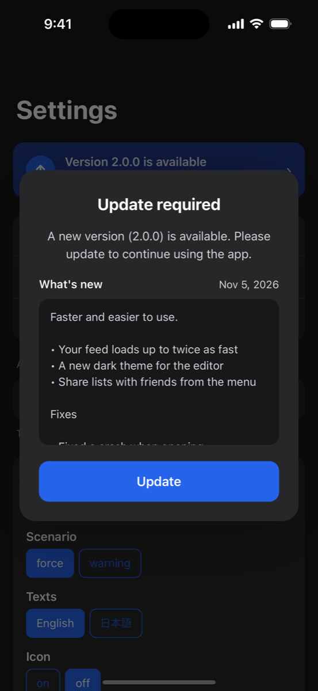
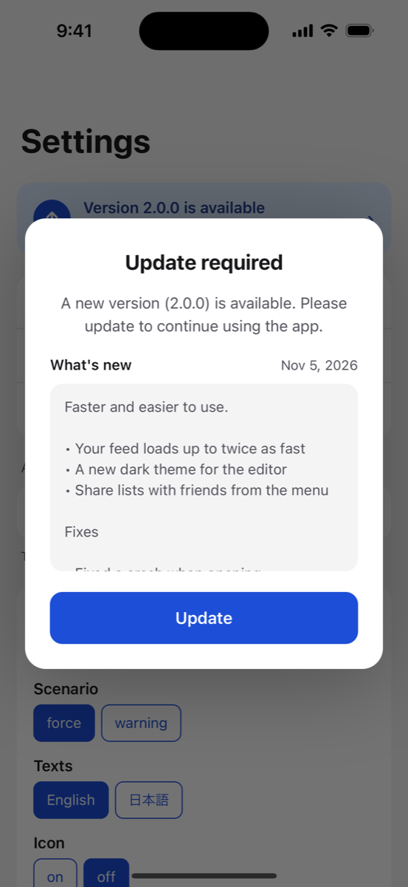
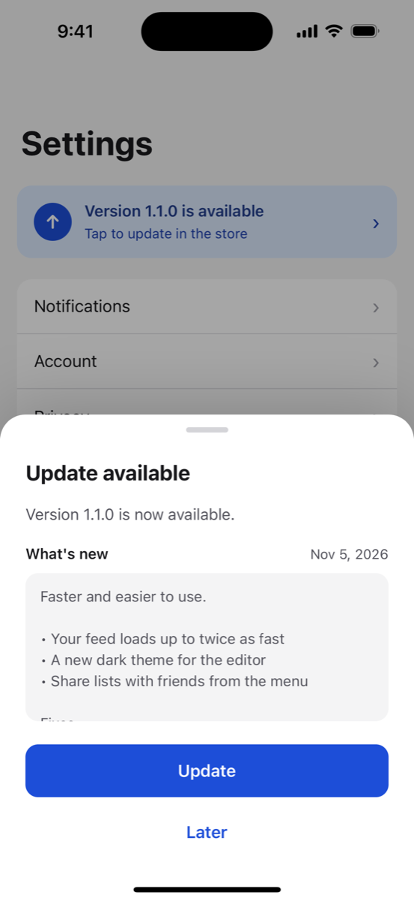
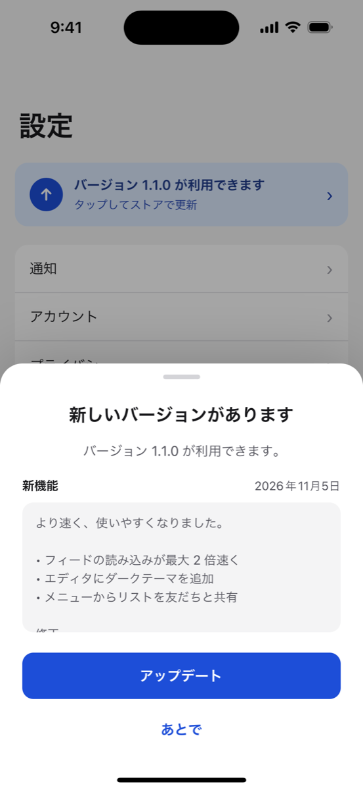
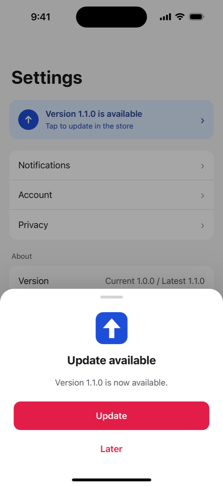
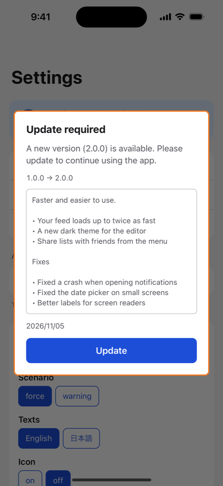
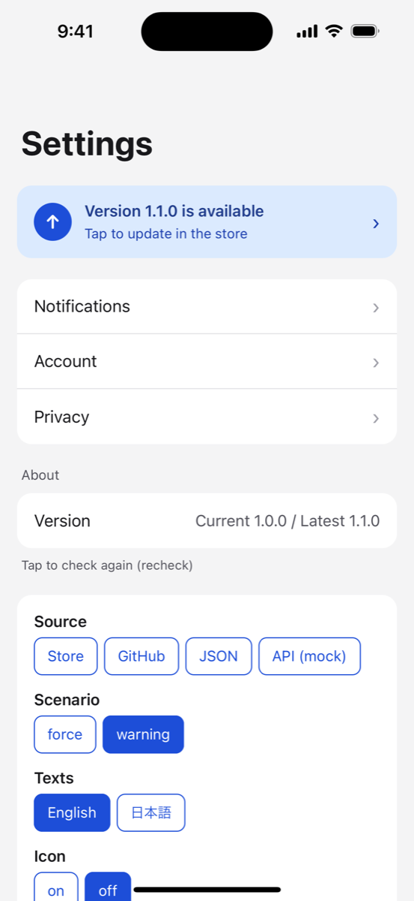

# Customizing the UI

[Back to README](../README.md)

Customize the default UI, or replace it with your own screen.

Three levels, from the smallest change to full control.

The default UI follows the device's light / dark appearance (shown here with [`showReleaseNotes`](../README.md#provider-props)):

<p>
  
</p>

## 1. Texts

```tsx
<StoreVersionProvider
  texts={{
    force: { title: 'Update required', update: 'Update now' },
    warning: { later: 'Not now' },
  }}
>
```

Keys you don't set fall back to the English defaults (merged per `force` / `warning`). `{remote}` and `{local}` are replaced with the latest / current version when shown.

| Key                   | Default                                                                         |
| --------------------- | ------------------------------------------------------------------------------- |
| `force.title`         | Update required                                                                 |
| `force.message`       | A new version ({remote}) is available. Please update to continue using the app. |
| `force.update`        | Update                                                                          |
| `force.whatsNew`      | What's new                                                                      |
| `force.releaseDate`   | {monthShort} {day}, {year}                                                      |
| `warning.title`       | Update available                                                                |
| `warning.message`     | Version {remote} is now available.                                              |
| `warning.update`      | Update                                                                          |
| `warning.later`       | Later                                                                           |
| `warning.whatsNew`    | What's new                                                                      |
| `warning.releaseDate` | {monthShort} {day}, {year}                                                      |

The default UI uses `whatsNew` and `releaseDate` only with [`showReleaseNotes`](../README.md#provider-props): the heading of the release notes section and the format of the release date next to it ([`components`](#2-components) get them in `texts` too). `releaseDate` is a format, not a text: `{year}` (4 digits), `{month}` (1 to 12), `{monthShort}` (`Jan` to `Dec`, always English) and `{day}` (1 to 31) are replaced with the parts of the store's release date, read in the device's time zone (`{remote}` / `{local}` are not replaced in it). The default gives a date like `Nov 5, 2026`.

With `showReleaseNotes`, the force card and the warning sheet show the store's release notes (scrollable) and release date:

|                                                                                  Force update                                                                                   |                                                                                    Update available                                                                                    |
| :-----------------------------------------------------------------------------------------------------------------------------------------------------------------------------: | :------------------------------------------------------------------------------------------------------------------------------------------------------------------------------------: |
|  |  |

A Japanese preset is included:

```tsx
import ja from 'react-native-store-version/texts/ja';

<StoreVersionProvider texts={ja}>

// start from the preset and change one key
<StoreVersionProvider texts={{ ...ja, force: { ...ja.force, title: '更新してください' } }}>
```

In the preset, `whatsNew` is `新機能` and `releaseDate` is `{year}年{month}月{day}日` (a date like `2026年11月5日`). With `texts={ja}` and `showReleaseNotes`:

<p>
  
</p>

Changing `texts` updates a modal that is already on screen, so it follows an in-app language switch. To use an i18n library, put a small wrapper inside its provider:

```tsx
import { useTranslation } from 'react-i18next';

function AppStoreVersionProvider({ children }: { children: React.ReactNode }) {
  const { t } = useTranslation();
  return (
    <StoreVersionProvider
      texts={{
        force: {
          title: t('update.force.title'),
          message: t('update.force.message'),
          update: t('update.button'),
          whatsNew: t('update.whatsNew'),
          releaseDate: t('update.releaseDate'), // a format such as '{monthShort} {day}, {year}'
        },
        warning: {
          title: t('update.warning.title'),
          message: t('update.warning.message'),
          update: t('update.button'),
          later: t('update.later'),
          whatsNew: t('update.whatsNew'),
          releaseDate: t('update.releaseDate'),
        },
      }}
    >
      {children}
    </StoreVersionProvider>
  );
}
```

## Icon and button color

```tsx
<StoreVersionProvider
  icon={require('./assets/icon.png')} // shown centered above the title; omitted = no icon
  primaryColor="#E11D48"              // the "Update" button fill and the "Later" label; same in light and dark
>
```

The app icon isn't read automatically (it can't be done from JavaScript reliably on both platforms), so pass it as an image source. `primaryColor` applies to both color schemes; if you want a different color per scheme, pass a value you picked with `useColorScheme()` (or `DynamicColorIOS` on iOS). Keep it readable on white (button label) and on the dark sheet background.

<p>
  
</p>

## 2. Components

Replace the contents of the force card and / or the warning sheet. The library still owns the modal, the backdrop, the placement (force: centered with 24 px side margins; warning: full width at the bottom), the back-button / backdrop-tap behavior, and the open / close animation. Your component draws the surface itself (background, radius, shadow, max width). The example app replaces the force card with one that shows the versions, the release notes and the release date ([`example/src/CustomUi.tsx`](../example/src/CustomUi.tsx)):

<p>
  
</p>

```tsx
import type { StoreVersionForceProps, StoreVersionWarningProps } from 'react-native-store-version';

function MyForce({ texts, local, remote, releaseNotes, openStore }: StoreVersionForceProps) {
  return (
    <View style={styles.card}>
      <Text accessibilityRole="header">{texts.title}</Text>
      <Text>{texts.message}</Text>
      <Text>{local} → {remote ?? '?'}</Text>
      {releaseNotes ? <Text numberOfLines={4}>{releaseNotes}</Text> : null}
      <Button title={texts.update} onPress={() => void openStore()} />
    </View>
  );
}

function MyWarning({ texts, openStore, dismiss }: StoreVersionWarningProps) {
  return (
    <View style={styles.sheet}>
      <Text accessibilityRole="header">{texts.title}</Text>
      <Text>{texts.message}</Text>
      <Button title={texts.later} onPress={dismiss} />
      <Button title={texts.update} onPress={() => void openStore()} />
    </View>
  );
}

// define the components outside render: a new component function on each render remounts the card's contents
// (a new `components` object on each render is fine)
const components = { Force: MyForce, Warning: MyWarning };

<StoreVersionProvider components={components}>
```

Props: `local`, `remote` (may be `null` when only the minimum version could be compared), `storeUrl`, `releaseNotes` and `releaseDate` (from the store, on iOS and Android; `undefined` with `getLatestVersion` or when the store has none; `releaseDate` is an ISO 8601 UTC string such as `2026-11-05T22:49:03Z`), `texts` (`{remote}` / `{local}` are already replaced; `texts.releaseDate` is passed as the format, with its placeholders, so to show a date, format the ISO value in `releaseDate` yourself), `icon`, `openStore()`; `Warning` also gets `dismiss()`. `primaryColor` does not apply to replaced components. A full example is in [`example/src/CustomUi.tsx`](../example/src/CustomUi.tsx).

## 3. Hook only

Pass `ui={false}` and render whatever you like with [`useStoreVersion`](./hook.md#usestoreversion-hook), for example a dedicated screen in your navigator.

```tsx
<StoreVersionProvider ui={false}>
```

The example app shows a banner on its settings screen this way ([`example/src/SettingsScreen.tsx`](../example/src/SettingsScreen.tsx)):

<p>
  
</p>
